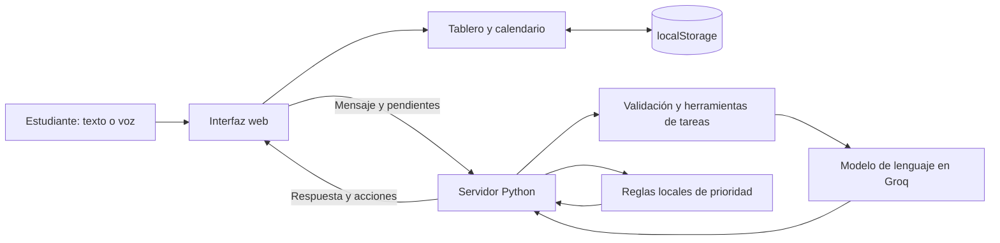

# PlanificaIA

**Agente inteligente para organizar tareas académicas**  
Proyecto de la electiva **Aplicaciones con Inteligencia Artificial** — Corporación Universitaria del Huila (CORHUILA).  
**Integrantes:** Dayana Sofía Méndez Perafán y Sneyder Díaz.

🌐 **[Abrir aplicación pública](https://planificaia.onrender.com/)** · 📄 **[Leer informe final en PDF](informe/Informe_Final_PlanificaIA_APA7.pdf)**

## ¿Qué problema resuelve?

Cuando varias actividades tienen fechas y prioridades distintas, elegir por dónde empezar toma tiempo. PlanificaIA reúne los pendientes en un tablero, muestra las entregas en un calendario y recomienda la siguiente tarea con un criterio verificable. El estudiante puede gestionarlas manualmente o conversar con un agente que interpreta instrucciones en lenguaje natural.

## Funciones implementadas

| Función | Comportamiento |
| --- | --- |
| Gestión de tareas | Crear, editar, completar y eliminar; registrar título, fecha, prioridad, materia, notas y tiempo estimado. |
| Chat con IA | Responder preguntas y ejecutar acciones sobre tareas mediante Groq; solicitar información faltante cuando sea necesario. |
| Voz | Dictar mensajes con el micrófono y, si se activa la casilla, escuchar las respuestas. Depende del soporte y permisos del navegador. |
| Priorización | Ordenar primero vencidas, luego fechas más cercanas y finalmente prioridad; explicar la recomendación. |
| Calendario | Navegar por meses, ver tareas de cada día y resaltar vencidas en rojo. |
| Seguimiento | Buscar, filtrar pendientes y completadas, ver progreso e historial. |
| Exportación | **Exportar PDF** prepara únicamente las tareas pendientes y abre la impresión del navegador; elegir **Guardar como PDF**. |

La versión web conserva las tareas en `localStorage` del navegador. Al recargar la página en ese mismo navegador siguen disponibles; cada navegador y dispositivo tiene su propia lista. La versión de consola guarda sus tareas por separado en `tareas.json`.

## ¿Cómo funciona el agente?



El servidor recibe una solicitud, valida los datos y usa el modelo para interpretar la intención. Las herramientas del agente pueden crear, modificar, completar o consultar tareas. La respuesta devuelve las acciones efectuadas y el navegador actualiza su lista. La recomendación determinista está disponible mediante reglas locales: vencimiento, fecha y prioridad. La consulta conversacional `/api/chat` sí requiere la clave de Groq.

**Criterio local:** una tarea vencida va antes que una futura; entre tareas del mismo grupo se atiende la fecha más próxima; si empatan, gana prioridad alta, media y baja. Las tareas sin fecha quedan después de las fechadas. La versión de consola permite comprobar esta regla sin conexión a Groq.

## Ejecutar en el computador

**Requisito:** Python 3.10 o superior. El proyecto usa la biblioteca estándar de Python; `requirements.txt` no instala paquetes adicionales.

1. Clona el repositorio y entra en la carpeta:

   ```bash
   git clone https://github.com/DayanaMendess/PlanificaIA.git
   cd PlanificaIA
   ```

2. Para activar el chat, copia `.env.example` a `.env` y reemplaza `TU_API_KEY_AQUI` por la clave autorizada de Groq. En PowerShell: `Copy-Item .env.example .env`. Este archivo es privado y está excluido de Git.

3. Inicia el servidor:

   ```bash
   python web_app.py
   ```

   En Windows también puedes abrir `Iniciar_PlanificaIA.bat`. Después visita **http://127.0.0.1:8000/**. Para detenerlo, pulsa `Ctrl+C` en la terminal.

4. Para ejecutar la versión de consola por separado:

   ```bash
   python agente_tareas.py
   ```

La interfaz web sigue permitiendo registrar tareas manualmente si no hay clave. El indicador **IA Groq activa** confirma que la clave está configurada en el servidor; una respuesta real del chat confirma además la conexión con el proveedor.

## Uso rápido para la sustentación

1. Abre la [aplicación publicada](https://planificaia.onrender.com/) y crea dos tareas de ejemplo con fechas diferentes.
2. Comprueba que aparecen en el tablero y en el calendario. Una fecha vencida se resalta en rojo.
3. Escribe en el chat **«¿Qué debería hacer primero?»** y explica el orden de vencimiento, fecha y prioridad.
4. Prueba **«Crea una tarea de exposición para el lunes, prioridad alta»**. Si falta un dato, responde a la pregunta del agente.
5. Activa **Leer mis respuestas en voz alta** y usa el micrófono en Chrome o Edge si el equipo concede permiso.
6. Completa una tarea y verifica su historial. Pulsa **Exportar PDF** y elige **Guardar como PDF** para obtener el listado de pendientes.

El tablero de un navegador nuevo comienza vacío porque no hay cuentas ni una base de datos compartida. Por eso conviene preparar las tareas de demostración en el mismo navegador que se mostrará durante la presentación.

## API y estructura del proyecto

| Archivo o ruta | Propósito |
| --- | --- |
| `agente_tareas.py` | Validación, operaciones de tareas, reglas de prioridad, herramientas del chat, integración con Groq y modo de consola. |
| `web_app.py` | Servidor HTTP, validación de solicitudes y rutas de API. |
| `dist/index.html` | Interfaz, audio del navegador, calendario, tablero y diseño de impresión PDF. |
| `render.yaml` | Blueprint del servicio web en Render. |
| `.env.example` | Ejemplo de configuración local, sin clave real. |
| `informe/Informe_Final_PlanificaIA_APA7.pdf` | Informe académico con desarrollo, evidencias, resultados y referencias. |

| Método y ruta | Uso |
| --- | --- |
| `GET /` | Entrega la interfaz web. |
| `GET /health` | Devuelve `{"status":"ok"}` para el control de salud. |
| `GET /api/estado` | Indica si Groq está configurado, sin revelar la clave. |
| `POST /api/chat` | Recibe mensajes y tareas pendientes; devuelve respuesta, tareas y acciones. |
| `POST /api/recomendar` | Devuelve recomendación con Groq o, si no está disponible, con reglas locales. |

Ejemplo de consulta local de recomendación:

```bash
curl -X POST http://127.0.0.1:8000/api/recomendar \
  -H "Content-Type: application/json" \
  -d '{"hoy":"2026-11-07","tareas":[{"titulo":"Preparar exposición","fecha_limite":"2026-11-09","prioridad":"alta"}]}'
```

En la consola, escribe `ayuda` para ver los comandos. Una secuencia de prueba es:

```text
agregar Preparar exposición | 2026-11-09 | alta
agregar Leer capítulo | 2026-11-12 | media
listar
recomendar
salir
```

La recomendación local selecciona **Preparar exposición** porque vence primero. La interfaz publicada también se comprobó con una pregunta real al chat; el agente respondió qué operaciones puede realizar. Los resultados y capturas están documentados en el [informe final](informe/Informe_Final_PlanificaIA_APA7.pdf).

## Despliegue y seguridad

El servicio público está alojado en Render. El archivo `render.yaml` instala las dependencias, inicia `python web_app.py` y comprueba `/health`. La variable `GROQ_API_KEY` se introduce en **Render → Environment**; no se guarda en el código, HTML, PDF ni repositorio. Consulta [README_RENDER.md](README_RENDER.md) para reproducir o actualizar el despliegue.

El navegador envía el mensaje y los datos necesarios de tareas pendientes al servidor para procesar el chat. El servidor no conserva la lista web. El código valida tamaño y formato de solicitudes, limita las consultas por IP y no incluye la clave en las respuestas. Usa datos académicos de prueba, sin información sensible.

**Límites del prototipo:** las tareas no se sincronizan entre dispositivos; el micrófono y la voz dependen del navegador; el plan gratuito de Render puede tardar en iniciar tras un periodo sin uso. La exportación se hace desde el diálogo de impresión del navegador.

## Entrega académica

El [informe en PDF](informe/Informe_Final_PlanificaIA_APA7.pdf) contiene portada institucional, introducción, objetivos, desarrollo, pruebas en consola y web, resultados, conclusiones y referencias. Para la entrega del parcial, incluir el código y ese PDF en un ZIP. La aplicación pública sirve para la sustentación en vivo.

